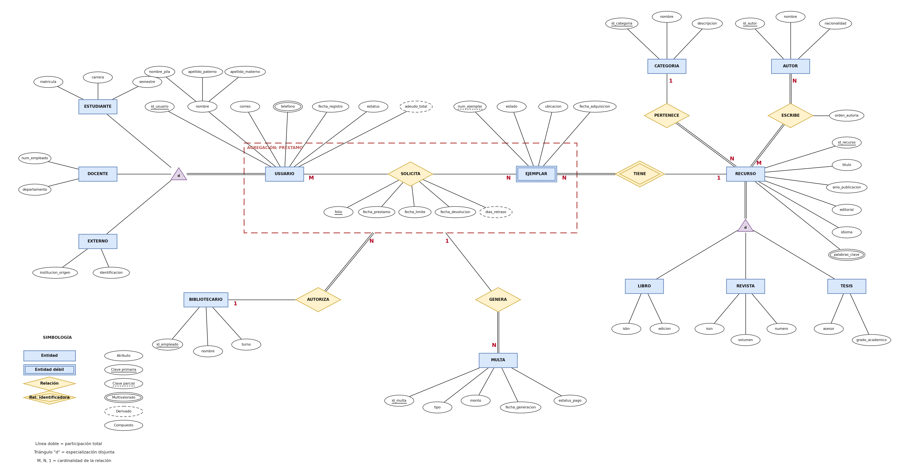

# Tarea 2.1: Modelado conceptual E-R y E-R Extendido de un caso real

## Datos del alumno

| | |
|---|---|
| **Alumno** | Edgar Alejandro Hernandez Guajardo |
| **Matrícula** | I24050409 |
| **Docente** | Ing. Ruben Riojas |
| **Institución** | Instituto Tecnológico Superior de Monclova |
| **Unidad** | Unidad 2: Diseño de bases de datos con el modelo E-R |
| **Actividad** | Tarea 2.1 |

## Descripción de la tarea

Modelado conceptual de un caso real: el **sistema de gestión de la biblioteca** de una institución educativa. Se redacta el planteamiento del problema, se extraen las reglas de negocio, se identifican entidades, atributos (claves, compuestos, derivados y multivalorados) y relaciones con sus cardinalidades y restricciones de participación, y se aplican conceptos del modelo E-R extendido (especialización/generalización, jerarquías y agregación). El diagrama se elaboró con la herramienta CASE **draw.io (diagrams.net)**.

## 📄 Documentación y archivos

- 👉 [**Reporte técnico en PDF**](documentacion/Tarea_2.1_Modelado_ER.pdf)
- 🧩 [Archivo fuente del diagrama (`.drawio`)](diagramas/modelo_er_biblioteca_itsm.drawio): ábrelo en [app.diagrams.net](https://app.diagrams.net/)
- 🖼️ Exportaciones: [PNG](diagramas/modelo_er_biblioteca_itsm.png) · [SVG](diagramas/modelo_er_biblioteca_itsm.svg) · [PDF](diagramas/modelo_er_biblioteca_itsm.pdf)

## Diagrama E-R extendido



## Resumen del modelo

| Elemento | Contenido |
|---|---|
| **Entidades fuertes** | USUARIO, RECURSO, AUTOR, CATEGORIA, BIBLIOTECARIO, MULTA |
| **Entidad débil** | EJEMPLAR (identificada por RECURSO mediante TIENE) |
| **Especialización (total, disjunta)** | USUARIO → ESTUDIANTE, DOCENTE, EXTERNO · RECURSO → LIBRO, REVISTA, TESIS |
| **Agregación** | SOLICITA (USUARIO – EJEMPLAR) como PRÉSTAMO, relacionado con BIBLIOTECARIO (AUTORIZA) y MULTA (GENERA) |
| **Atributos especiales** | Compuesto: `nombre` · Multivalorados: `telefono`, `palabras_clave` · Derivados: `adeudo_total`, `dias_retraso` |

## Estructura de la carpeta

```
Unidad2/
└── Tarea 2.1/
    ├── Readme.md
    ├── documentacion/
    │   ├── Tarea_2.1_Modelado_ER.docx
    │   └── Tarea_2.1_Modelado_ER.pdf
    └── diagramas/
        ├── modelo_er_biblioteca_itsm.drawio   (fuente editable)
        ├── modelo_er_biblioteca_itsm.png
        ├── modelo_er_biblioteca_itsm.svg
        └── modelo_er_biblioteca_itsm.pdf
```

## Referencias (APA 7)

- Chen, P. P.-S. (1976). The entity-relationship model—Toward a unified view of data. *ACM Transactions on Database Systems, 1*(1), 9–36. https://doi.org/10.1145/320434.320440
- Connolly, T., & Begg, C. (2015). *Database systems: A practical approach to design, implementation, and management* (6.ª ed.). Pearson.
- Coronel, C., & Morris, S. (2019). *Database systems: Design, implementation, & management* (13.ª ed.). Cengage Learning.
- Elmasri, R., & Navathe, S. B. (2016). *Fundamentals of database systems* (7.ª ed.). Pearson.
- JGraph Ltd. (s. f.). *draw.io (diagrams.net)* [Software]. https://www.drawio.com/
- Silberschatz, A., Korth, H. F., & Sudarshan, S. (2019). *Database system concepts* (7.ª ed.). McGraw-Hill Education.
- Teorey, T., Lightstone, S., Nadeau, T., & Jagadish, H. V. (2011). *Database modeling and design: Logical design* (5.ª ed.). Morgan Kaufmann.

## 🎥 Video explicativo

▶️ Explicación de los temas en YouTube: [PEGA AQUÍ EL ENLACE DE TU VIDEO](https://www.youtube.com/)
