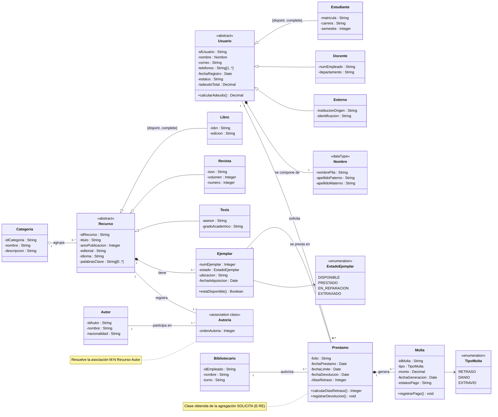

# Tarea 2.2: Transición de diagrama E-R a notación UML

## Datos del alumno

| | |
|---|---|
| **Alumno** | Edgar Alejandro Hernandez Guajardo |
| **Matrícula** | I24050409 |
| **Docente** | Ing. Ruben Riojas |
| **Institución** | Instituto Tecnológico Superior de Monclova |
| **Unidad** | Unidad 2: Diseño de bases de datos con el modelo E-R |
| **Actividad** | Tarea 2.2 |

## Descripción de la tarea

**Punto de partida:** el diagrama E-R extendido de la [Tarea 2.1](../../Tarea%202.1/) (sistema de gestión de una biblioteca), que incluye una entidad débil, dos jerarquías de especialización y una agregación.

**Objetivo:** convertir ese diagrama conceptual a un **diagrama de clases en notación UML**, estableciendo la correspondencia directa entre entidades y clases, atributos y propiedades, y relaciones y asociaciones (composición, agregación y herencia), y analizar las coincidencias y diferencias entre ambos modelos para el desarrollo orientado a objetos.

**Alcance del trabajo:**

1. Reglas de transformación de cada concepto del E-R/E-RE a su equivalente en UML.
2. Correspondencia de **entidades → clases**, **atributos → propiedades** y **relaciones → asociaciones**, con sus multiplicidades.
3. Diagrama de clases completo y tres vistas por módulo (usuarios, recursos y préstamos), elaborados con **Mermaid** (código editable).
4. **Comparativa detallada E-R vs. UML** y análisis de coincidencias y diferencias.
5. Implicaciones para el desarrollo orientado a objetos: traducción a código y a base de datos.

## Estructura de la carpeta

```
Unidad2/
└── Tarea 2.2/
    ├── Readme.md
    ├── documentacion/
    │   ├── Tarea_2.2_ER_a_UML.docx
    │   └── Tarea_2.2_ER_a_UML.pdf
    └── diagramas/
        ├── diagrama_clases_uml_biblioteca.mmd   (fuente editable)
        ├── diagrama_clases_uml_biblioteca.png
        ├── diagrama_clases_uml_biblioteca.svg
        ├── diagrama_clases_uml_biblioteca.pdf
        └── modulos/
            ├── modulo_usuarios.(mmd|png|svg)
            ├── modulo_recursos.(mmd|png|svg)
            └── modulo_prestamos.(mmd|png|svg)
```

Los archivos `.mmd` son las **fuentes editables** (Mermaid); los `.png`, `.svg` y `.pdf` son sus exportaciones.

## 📄 Documentación y archivos

- 👉 [**Documento PDF con la comparativa E-R vs. UML**](documentacion/Tarea_2.2_ER_a_UML.pdf)
- 🧩 [Fuente editable del diagrama de clases (`.mmd`)](diagramas/diagrama_clases_uml_biblioteca.mmd)
- 🖼️ Exportaciones: [PNG](diagramas/diagrama_clases_uml_biblioteca.png) · [SVG](diagramas/diagrama_clases_uml_biblioteca.svg) · [PDF](diagramas/diagrama_clases_uml_biblioteca.pdf)

## Diagrama de clases UML



## Correspondencia general E-R → UML

| Concepto E-R / E-RE | Elemento UML |
|---|---|
| Entidad | Clase |
| Entidad débil + relación identificadora | Clase unida por **composición** |
| Atributo simple / clave | Propiedad (con tipo y visibilidad) |
| Atributo compuesto | Clase «dataType» + composición |
| Atributo multivalorado | Propiedad con multiplicidad `[1..*]` o `[0..*]` |
| Atributo derivado | Propiedad derivada `/atributo` + operación de cálculo |
| Relación binaria 1:N | Asociación con multiplicidades |
| Relación M:N con atributos | Clase de asociación |
| Cardinalidad y participación | Multiplicidad mínimo..máximo (total = mínimo 1; parcial = mínimo 0) |
| Especialización / generalización | **Herencia** con `{disjoint, complete}` |
| Agregación del E-RE | Clase (con asociaciones) |
| Dominio de valores cerrado | Enumeración «enumeration» |

## Relaciones y multiplicidades

| Relación E-R | Cardinalidad y participación (E-R) | Elemento UML | Multiplicidades |
|---|---|---|---|
| ES (USUARIO) | Especialización total y disjunta | Herencia | Usuario ◁— Estudiante, Docente, Externo |
| ES (RECURSO) | Especialización total y disjunta | Herencia | Recurso ◁— Libro, Revista, Tesis |
| TIENE (identificadora) | 1:N; EJEMPLAR total, RECURSO parcial | **Composición** | Recurso `1` ◆— `0..*` Ejemplar |
| PERTENECE | N:1; RECURSO total, CATEGORIA parcial | **Agregación** | Categoria `1` ◇— `0..*` Recurso |
| ESCRIBE | M:N; ambos totales; `orden_autoria` | Clase de asociación | Recurso `1` — `1..*` Autoria · Autor `1` — `1..*` Autoria |
| SOLICITA (PRÉSTAMO) | M:N; ambos parciales | Asociaciones a la clase Prestamo | Usuario `1` — `0..*` Prestamo · Ejemplar `1` — `0..*` Prestamo |
| AUTORIZA | 1:N; PRÉSTAMO total | Asociación | Bibliotecario `1` — `0..*` Prestamo |
| GENERA | 1:N; MULTA total | **Composición** | Prestamo `1` ◆— `0..*` Multa |
| Atributo compuesto `nombre` | — | **Composición** | Usuario `1` ◆— `1` Nombre |

## Comparativa resumida E-R vs. UML

| Aspecto | Modelo E-R | UML (diagrama de clases) |
|---|---|---|
| Propósito | Diseño de la base de datos | Diseño del software orientado a objetos |
| Elemento principal | Entidad | Clase |
| Comportamiento | No se representa | Operaciones |
| Identificador | Clave primaria | Identidad del objeto (la clave es una propiedad más) |
| Visibilidad y tipos | No se manejan | `+`, `-`, `#` y tipos de dato |
| Relaciones M:N | Directas | Clase de asociación o intermedia |
| Participación | Total / parcial (línea doble / simple) | Multiplicidad mínima |
| Todo-parte | Entidad débil | Composición y agregación |

> La comparativa completa, el análisis de coincidencias y diferencias y el ejemplo de traducción a código están en el [documento PDF](documentacion/Tarea_2.2_ER_a_UML.pdf).

## Cómo regenerar los diagramas

```bash
npm install -g @mermaid-js/mermaid-cli
mmdc -i diagramas/diagrama_clases_uml_biblioteca.mmd -o diagramas/diagrama_clases_uml_biblioteca.svg
```

También puedes editar el `.mmd` en línea en [mermaid.live](https://mermaid.live/).

## Referencias (APA 7)

- Booch, G., Rumbaugh, J., & Jacobson, I. (2005). *The Unified Modeling Language user guide* (2.ª ed.). Addison-Wesley.
- Chen, P. P.-S. (1976). The entity-relationship model—Toward a unified view of data. *ACM Transactions on Database Systems, 1*(1), 9–36. https://doi.org/10.1145/320434.320440
- Connolly, T., & Begg, C. (2015). *Database systems: A practical approach to design, implementation, and management* (6.ª ed.). Pearson.
- Elmasri, R., & Navathe, S. B. (2016). *Fundamentals of database systems* (7.ª ed.). Pearson.
- Fowler, M. (2004). *UML distilled: A brief guide to the standard object modeling language* (3.ª ed.). Addison-Wesley.
- Mermaid. (s. f.). *Mermaid: Diagramming and charting tool* [Software]. https://mermaid.js.org/
- Object Management Group. (2017). *OMG Unified Modeling Language (OMG UML), version 2.5.1* (formal/17-12-05). https://www.omg.org/spec/UML/2.5.1/
- Teorey, T., Lightstone, S., Nadeau, T., & Jagadish, H. V. (2011). *Database modeling and design: Logical design* (5.ª ed.). Morgan Kaufmann.

## 🎥 Video explicativo

▶️ Explicación de los temas en YouTube: [PEGA AQUÍ EL ENLACE DE TU VIDEO](https://www.youtube.com/)
