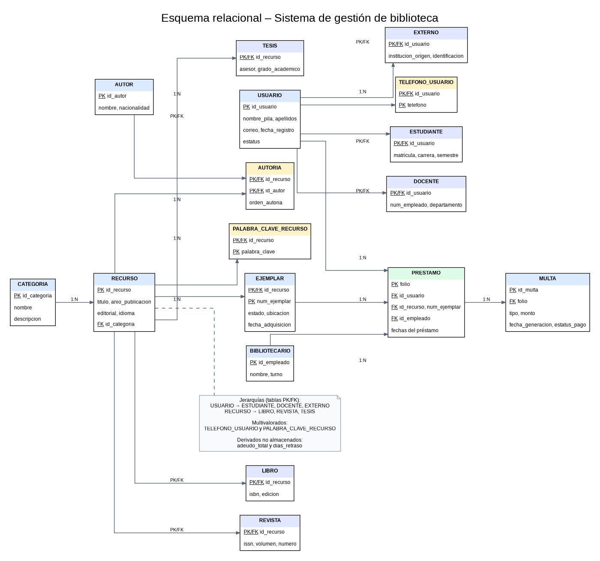

# Tarea 3.1: Transformación de Modelo E-R a Esquema Relacional y Reglas de Integridad

**Unidad 3 – Modelo relacional**  
**Proyecto:** Sistema de gestión de una biblioteca académica

---

## Datos del alumno

| Dato | Información |
|---|---|
| **Alumno** | Edgar Alejandro Hernández Guajardo |
| **Matrícula** | I24050409 |
| **Docente** | Ing. Ruben Riojas |
| **Institución** | Instituto Tecnológico Superior de Monclova |
| **Unidad** | Unidad 3: Modelo relacional |
| **Actividad** | Tarea 3.1 |

## Descripción de la tarea

### Punto de partida

Se toma como base el modelo E-R extendido del proyecto de biblioteca académica desarrollado en las actividades de la Unidad 2. A partir de sus entidades, atributos, relaciones, cardinalidades y jerarquías se construye el esquema relacional.

### Objetivo

Transformar el modelo conceptual E-R a un esquema relacional, aplicando las reglas de conversión y definiendo las llaves primarias (PK), llaves foráneas (FK) y restricciones de integridad necesarias para organizar correctamente la información.

### Alcance del trabajo

1. Investigación de los componentes formales del modelo relacional: relaciones, atributos, tuplas y dominios.
2. Explicación de las restricciones de integridad de entidad, referencial y de dominio.
3. Conversión de entidades fuertes, atributos compuestos, multivalorados y derivados.
4. Resolución de relaciones 1:N y M:N, entidad débil y jerarquías de especialización.
5. Elaboración del esquema tabular con identificación explícita de PK, FK y restricciones `UNIQUE`.
6. Representación gráfica del esquema relacional y propuesta de implementación en PostgreSQL.

## Estructura de la carpeta

```text
Tarea_3.1_Modelo_Relacional/
│
├── Readme.md
│
├── documentacion/
│   ├── Tarea_3.1_Reporte_Tecnico.pdf
│   └── esquema_relacional.sql
│
└── diagramas/
    ├── esquema_relacional.mmd       (fuente Mermaid editable)
    ├── esquema_relacional.drawio    (fuente editable en draw.io)
    ├── esquema_relacional.dot       (fuente Graphviz)
    ├── esquema_relacional.png       (vista previa del diagrama)
    ├── esquema_relacional.svg       (exportación vectorial)
    └── esquema_relacional.pdf       (exportación PDF)
```

## Documentación y archivos

- 📄 [Reporte técnico en PDF](documentacion/Tarea_3.1_Reporte_Tecnico.pdf) – investigación, reglas de transformación, esquema tabular, integridad y diagrama integrado en el apartado del esquema relacional.
- 🧩 [Esquema relacional en SQL](documentacion/esquema_relacional_SQLServer.sql) – propuesta de creación de tablas, PK, FK, restricciones `CHECK` y `UNIQUE` para PostgreSQL.
- 🖼️ [Diagrama en PNG](diagramas/esquema_relacional.png) – imagen para consulta rápida.
- 🔎 [Diagrama en SVG](diagramas/esquema_relacional.svg) – versión vectorial que puede ampliarse sin perder nitidez.
- 📐 [Diagrama en PDF](diagramas/esquema_relacional.pdf) – exportación del diagrama.
- ✏️ [Archivo editable draw.io](diagramas/esquema_relacional.drawio) – permite modificar las tablas y conexiones en diagrams.net.
- 📝 [Código fuente Mermaid](diagramas/esquema_relacional.mmd) – diagrama como texto editable.
- 🛠️ [Código fuente Graphviz](diagramas/esquema_relacional.dot) – fuente del diagrama exportado.

## Diagrama del esquema relacional

El diagrama muestra las tablas que componen la base de datos, las referencias entre ellas, las tablas asociativas, la entidad débil `EJEMPLAR` y las jerarquías de especialización de `USUARIO` y `RECURSO`.

### Vista previa



[Ver el diagrama en formato SVG](diagramas/esquema_relacional.svg) · [Abrir el archivo editable draw.io](diagramas/esquema_relacional.drawio) · [Consultar el código Mermaid](diagramas/esquema_relacional.mmd)

### Notación utilizada

| Símbolo | Significado |
|---|---|
| **PK** | Llave primaria: identifica de manera única cada registro y no admite valores nulos. |
| **FK** | Llave foránea: referencia la llave primaria o clave candidata de otra tabla. |
| **PK/FK** | Atributo que funciona simultáneamente como llave primaria y foránea; se utiliza en las tablas de subtipos. |
| **UK** | Restricción `UNIQUE`: evita que se repita un valor que debe ser único. |
| **1:N** | Una fila del lado 1 puede relacionarse con varias filas del lado N. |
| **M:N** | Relación de muchos a muchos, resuelta mediante una tabla asociativa. |

## Esquema tabular de la base de datos

A continuación se presenta la estructura de las relaciones resultantes. Los atributos marcados como **PK** forman la llave primaria; los marcados como **FK** referencian otra tabla; **UK** indica una restricción de unicidad.

| Tabla | Atributos y claves |
|---|---|
| **CATEGORIA** | `id_categoria` **PK**; `nombre`; `descripcion`. |
| **USUARIO** | `id_usuario` **PK**; `nombre_pila`; `apellido_paterno`; `apellido_materno`; `correo`; `fecha_registro`; `estatus`. |
| **ESTUDIANTE** | `id_usuario` **PK/FK** → `USUARIO`; `matricula` **UK**; `carrera`; `semestre`. |
| **DOCENTE** | `id_usuario` **PK/FK** → `USUARIO`; `num_empleado` **UK**; `departamento`. |
| **EXTERNO** | `id_usuario` **PK/FK** → `USUARIO`; `institucion_origen`; `identificacion`. |
| **TELEFONO_USUARIO** | `id_usuario` **PK/FK** → `USUARIO`; `telefono` **PK**. PK compuesta: (`id_usuario`, `telefono`). |
| **RECURSO** | `id_recurso` **PK**; `titulo`; `anio_publicacion`; `editorial`; `idioma`; `id_categoria` **FK** → `CATEGORIA`. |
| **LIBRO** | `id_recurso` **PK/FK** → `RECURSO`; `isbn` **UK**; `edicion`. |
| **REVISTA** | `id_recurso` **PK/FK** → `RECURSO`; `issn`; `volumen`; `numero`. |
| **TESIS** | `id_recurso` **PK/FK** → `RECURSO`; `asesor`; `grado_academico`. |
| **PALABRA_CLAVE_RECURSO** | `id_recurso` **PK/FK** → `RECURSO`; `palabra_clave` **PK**. PK compuesta: (`id_recurso`, `palabra_clave`). |
| **EJEMPLAR** | `id_recurso` **PK/FK** → `RECURSO`; `num_ejemplar` **PK**; `estado`; `ubicacion`; `fecha_adquisicion`. PK compuesta: (`id_recurso`, `num_ejemplar`). |
| **AUTOR** | `id_autor` **PK**; `nombre`; `nacionalidad`. |
| **AUTORIA** | `id_recurso` **PK/FK** → `RECURSO`; `id_autor` **PK/FK** → `AUTOR`; `orden_autoria`. PK compuesta: (`id_recurso`, `id_autor`). |
| **BIBLIOTECARIO** | `id_empleado` **PK**; `nombre`; `turno`. |
| **PRESTAMO** | `folio` **PK**; `id_usuario` **FK** → `USUARIO`; (`id_recurso`, `num_ejemplar`) **FK compuesta** → `EJEMPLAR`; `id_empleado` **FK** → `BIBLIOTECARIO`; `fecha_prestamo`; `fecha_limite`; `fecha_devolucion`. |
| **MULTA** | `id_multa` **PK**; `folio` **FK** → `PRESTAMO`; `tipo`; `monto`; `fecha_generacion`; `estatus_pago`. |

## Correspondencia general E-R a relacional

| Elemento del modelo E-R | Regla de transformación | Resultado en el esquema |
|---|---|---|
| Entidad fuerte | Se crea una tabla con sus atributos y su identificador como PK. | `USUARIO`, `RECURSO`, `AUTOR`, `CATEGORIA`, `BIBLIOTECARIO`, entre otras. |
| Atributo compuesto | Se descompone en atributos simples. | El nombre del usuario se representa con `nombre_pila`, `apellido_paterno` y `apellido_materno`. |
| Atributo multivalorado | Se crea una tabla independiente con la PK del propietario como FK. | `TELEFONO_USUARIO` y `PALABRA_CLAVE_RECURSO`. |
| Atributo derivado | Se calcula a partir de otros datos y no se almacena como columna ordinaria. | `adeudo_total` y `dias_retraso`. |
| Relación 1:N | La PK del lado 1 se propaga como FK al lado N. | `id_categoria` en `RECURSO`; `id_empleado` en `PRESTAMO`. |
| Relación M:N | Se crea una tabla asociativa que contiene las FKs de las entidades participantes. | `AUTORIA` y `PRESTAMO`. |
| Entidad débil | La PK del propietario se combina con la clave parcial de la entidad débil. | `EJEMPLAR` usa (`id_recurso`, `num_ejemplar`). |
| Jerarquía | Se conserva una tabla para el supertipo y una tabla para cada subtipo. | `USUARIO` → `ESTUDIANTE`, `DOCENTE`, `EXTERNO`; `RECURSO` → `LIBRO`, `REVISTA`, `TESIS`. |

## Relaciones, cardinalidades y resolución

| Relación del modelo | Cardinalidad / participación | Implementación relacional |
|---|---|---|
| `CATEGORIA` – `RECURSO` (PERTENECE) | 1:N; cada recurso pertenece a una categoría. | FK `id_categoria` en `RECURSO`. |
| `RECURSO` – `EJEMPLAR` (TIENE) | 1:N; un recurso puede tener varios ejemplares; el ejemplar depende de su recurso. | FK `id_recurso` y PK compuesta en `EJEMPLAR`. |
| `RECURSO` – `AUTOR` (ESCRIBE) | M:N; un recurso puede tener varios autores y un autor puede participar en varios recursos. | Tabla asociativa `AUTORIA`, con PK compuesta y atributo `orden_autoria`. |
| `USUARIO` – `EJEMPLAR` (SOLICITA / préstamo) | M:N a través del historial de préstamos. | Tabla `PRESTAMO`, con `folio` como PK y FKs hacia usuario y ejemplar. |
| `BIBLIOTECARIO` – `PRESTAMO` (AUTORIZA) | 1:N; un bibliotecario puede autorizar varios préstamos. | FK `id_empleado` en `PRESTAMO`. |
| `PRESTAMO` – `MULTA` (GENERA) | 1:N; un préstamo puede generar multas. | FK `folio` en `MULTA`. |
| `USUARIO` – subtipos | Especialización total y disjunta. | `ESTUDIANTE`, `DOCENTE` y `EXTERNO` usan `id_usuario` como PK/FK. |
| `RECURSO` – subtipos | Especialización total y disjunta. | `LIBRO`, `REVISTA` y `TESIS` usan `id_recurso` como PK/FK. |

**Relación 1:1:** el diagrama E-R de origen no presenta una relación 1:1 explícita. Por ello no se agrega una relación que no esté definida en el modelo conceptual.

## Reglas de integridad

### 1. Integridad de entidad
- Cada tabla cuenta con una llave primaria.
- Las PK no admiten valores nulos y deben identificar de forma única cada tupla.
- En `EJEMPLAR`, `TELEFONO_USUARIO`, `PALABRA_CLAVE_RECURSO` y `AUTORIA` se utilizan llaves primarias compuestas.

### 2. Integridad referencial
- Las llaves foráneas deben coincidir con registros existentes en las tablas referenciadas.
- `RECURSO.id_categoria` referencia `CATEGORIA`.
- `PRESTAMO` referencia `USUARIO`, `EJEMPLAR` y `BIBLIOTECARIO`.
- `AUTORIA` referencia `RECURSO` y `AUTOR`.
- Los subtipos referencian su supertipo mediante su propia PK.

### 3. Integridad de dominio
El SQL incorpora tipos de datos y restricciones para limitar los valores aceptados, por ejemplo:

- `CHECK (monto >= 0)` para evitar multas negativas.
- `CHECK (semestre > 0)` para validar el semestre.
- `CHECK (orden_autoria > 0)` para el orden de los autores.
- Restricciones de fechas para impedir que la fecha límite o devolución sean anteriores a la fecha del préstamo.
- `NOT NULL` para atributos obligatorios y `UNIQUE` para identificadores alternativos, como matrícula e ISBN.

### Validaciones adicionales

Las llaves foráneas por sí solas no garantizan que todo usuario tenga exactamente un subtipo, que cada recurso tenga exactamente un subtipo, que cada recurso tenga al menos un autor o ejemplar, ni que cada usuario registre uno o varios teléfonos. Estas reglas de participación total y disjunta requieren validación adicional, por ejemplo mediante triggers diferidos o lógica transaccional.

## Atributos derivados

| Atributo derivado | Forma de obtenerlo |
|---|---|
| `dias_retraso` | Diferencia entre `fecha_devolucion` y `fecha_limite`, con mínimo cero, cuando el préstamo ya fue devuelto. |
| `adeudo_total` | Suma de los montos de las multas pendientes asociadas a los préstamos del usuario. |

Estos valores no se almacenan como columnas ordinarias para evitar duplicidad y posibles inconsistencias.


## Consideraciones de implementación

El archivo SQL es una propuesta para PostgreSQL. Los tipos, longitudes y dominios cerrados deben validarse con las reglas definitivas de la biblioteca. En particular, los valores permitidos para `estado`, `tipo` y `estatus_pago` deben acordarse antes de utilizar la base de datos en un entorno real.

## Conclusión

La transformación del modelo E-R al esquema relacional permitió organizar la información de la biblioteca mediante tablas relacionadas y claves que mantienen la consistencia de los datos. Las relaciones 1:N se resolvieron propagando llaves foráneas; las relaciones M:N mediante tablas asociativas; la entidad débil mediante una llave compuesta; y las jerarquías mediante tablas de supertipo y subtipo. Las restricciones de integridad y las validaciones adicionales completan la propuesta lógica de la base de datos.

## Referencias

- Chen, P. P.-S. (1976). The entity-relationship model—Toward a unified view of data. *ACM Transactions on Database Systems, 1*(1), 9–36. https://doi.org/10.1145/320434.320440
- Connolly, T., & Begg, C. (2015). *Database systems: A practical approach to design, implementation, and management* (6.ª ed.). Pearson.
- Elmasri, R., & Navathe, S. B. (2016). *Fundamentals of database systems* (7.ª ed.). Pearson.
- Silberschatz, A., Korth, H. F., & Sudarshan, S. (2019). *Database system concepts* (7.ª ed.). McGraw-Hill Education.
- PostgreSQL Global Development Group. (s. f.). *PostgreSQL documentation*. https://www.postgresql.org/docs/

---

## 🎥 Video explicativo

▶️ Explicación de los temas en YouTube: [PEGA AQUÍ EL ENLACE DE TU VIDEO](https://www.youtube.com/)
