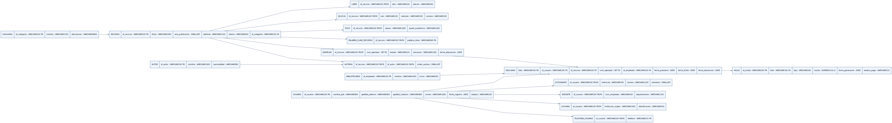

# Tarea 3.2 — Esquema físico de biblioteca en SQL Server

**Unidad 3: Modelo relacional**  
**Alumno:** Edgar Alejandro Hernández Guajardo · **Matrícula:** I24050409  
**Institución:** Instituto Tecnológico Superior de Monclova  
**Docente:** Ing. Ruben Riojas

## Objetivo

Implementar en Microsoft SQL Server el esquema relacional de biblioteca de la Tarea 3.1 mediante un script DDL con tablas, PK, FK, CHECK, NOT NULL, UNIQUE y acciones referenciales.

## Archivos

- [Reporte técnico PDF](documentacion/Tarea_3.2_Reporte_Tecnico_SQLServer.pdf)
- [Script SQL Server schema.sql](documentacion/schema.sql)
- [Diagrama PNG](diagramas/esquema_fisico.png)
- [Diagrama SVG](diagramas/esquema_fisico.svg)
- [Diagrama PDF](diagramas/esquema_fisico.pdf)
- [Mermaid editable](diagramas/esquema_fisico.mmd)
- [Draw.io editable](diagramas/esquema_fisico.drawio)
- [Guía de evidencias](evidencias/GUIA_EVIDENCIAS_SQLSERVER.md)

## Diagrama físico

## Tablas del esquema

| Tabla | Función |
|---|---|
| categoria | Clasificación de recursos |
| usuario | Personas usuarias |
| estudiante | Subtipo de usuario |
| docente | Subtipo de usuario |
| externo | Subtipo de usuario |
| telefono_usuario | Teléfonos de usuarios |
| recurso | Material bibliográfico |
| libro | Subtipo de recurso |
| revista | Subtipo de recurso |
| tesis | Subtipo de recurso |
| palabra_clave_recurso | Palabras clave |
| autor | Autores |
| autoria | Relación entre autor y recurso |
| ejemplar | Copias de un recurso |
| bibliotecario | Personal responsable |
| prestamo | Historial de préstamos |
| multa | Sanciones relacionadas con préstamos |

El diccionario completo de columnas, tipos y nulabilidad se encuentra en el PDF.

## Datos de prueba\n\nEl archivo `documentacion/schema.sql` incluye sentencias `INSERT INTO` con datos ficticios en las **17 tablas**, respetando las llaves foráneas. Incluye consultas `SELECT` para verificar el número de registros y consultar préstamos relacionados con usuarios y recursos. Los datos se insertan en una transacción con `TRY/CATCH` y reversión en caso de error. **Ejecutar sobre una base nueva**, ya que volver a ejecutar el script producirá conflictos por tablas y claves existentes.\n\n## Ejecutar en SQL Server Management Studio

1. Conéctate a SQL Server.
2. Crea una base de datos llamada `Biblioteca`.
3. Selecciona la base de datos `Biblioteca`.
4. Abre `documentacion/schema.sql` y ejecútalo con **F5**.
5. Verifica que existan 17 tablas con la consulta al final del script.
6. Captura la ejecución, las restricciones y el diagrama generado en SSMS.

> La revisión realizada es estática. No se afirma que el script se haya ejecutado en SQL Server ni que las capturas sean reales. Completa la carpeta de evidencias con capturas de tu instancia.

## Integridad

El archivo define 17 PK y 16 FK, además de CHECK, UNIQUE y NOT NULL. Usa ON DELETE CASCADE en dependencias correspondientes y NO ACTION para otras relaciones. Las jerarquías total/disjunta necesitan validaciones transaccionales adicionales.

## Referencias

- [CREATE TABLE — Microsoft Learn](https://learn.microsoft.com/sql/t-sql/statements/create-table-transact-sql)
- [Primary and foreign key constraints — Microsoft Learn](https://learn.microsoft.com/sql/relational-databases/tables/primary-and-foreign-key-constraints)
