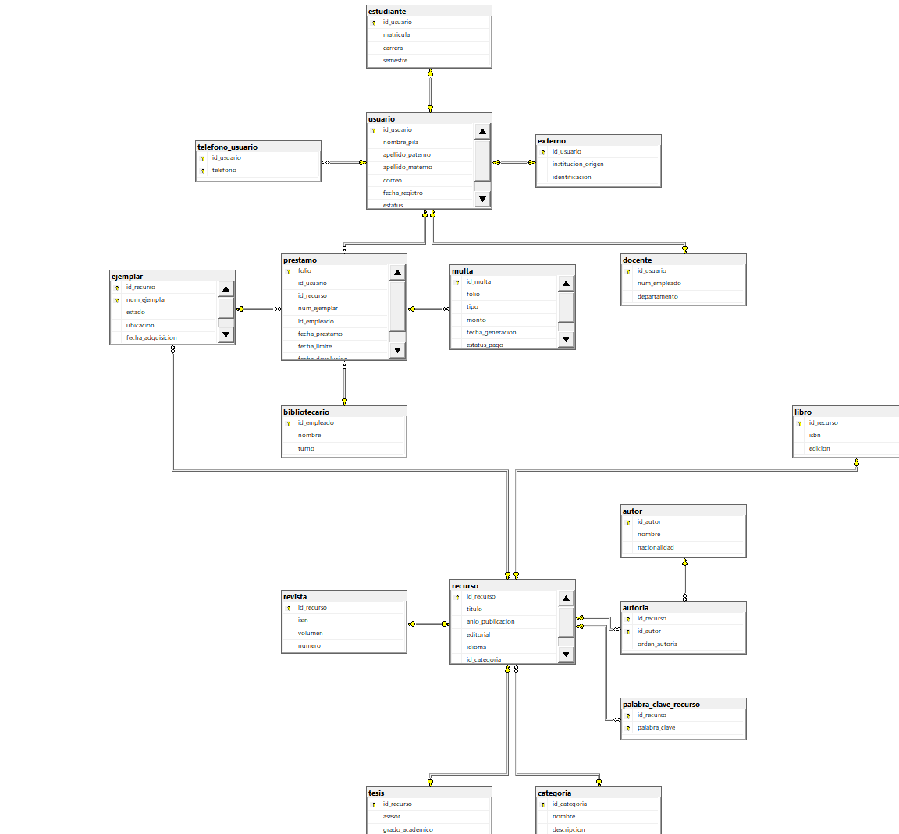
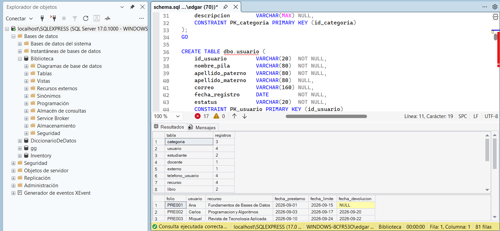
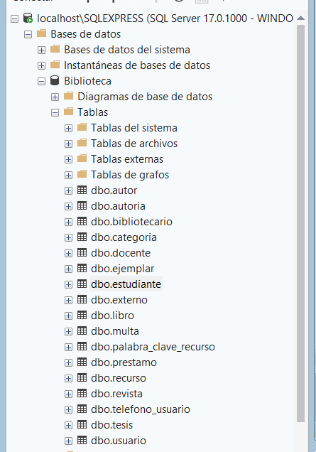

# Tarea 3.2 — Generación del esquema físico en SQL Server

**Unidad 3: Modelo relacional**  
**Proyecto:** Sistema de gestión de una biblioteca académica  
**SGBD:** Microsoft SQL Server · **Herramienta:** SQL Server Management Studio (SSMS)

## Datos académicos

| Dato | Información |
|---|---|
| Institución | Instituto Tecnológico Superior de Monclova |
| Materia | Fundamentos de Bases de Datos |
| Alumno | Edgar Alejandro Hernández Guajardo |
| Matrícula | I24050409 |
| Docente | Ing. Ruben Riojas |
| Actividad | Tarea 3.2 — Generación del esquema físico en SGBD y script LDD |

## 1. Descripción del proyecto

Esta actividad continúa el diseño relacional de la Tarea 3.1. El sistema de biblioteca académica gestiona usuarios, recursos bibliográficos, ejemplares, autores, préstamos y multas. El esquema físico se implementa mediante **17 tablas** del esquema `dbo`, con claves primarias, claves foráneas, restricciones de integridad y datos de prueba.

## 2. Objetivo

Generar el esquema físico en Microsoft SQL Server y documentar su implementación mediante un script DDL (`schema.sql`), diccionario de datos, diagrama generado en SSMS y evidencias de ejecución.

## 3. Entregables y archivos

| Archivo | Contenido |
|---|---|
| [Reporte técnico PDF](documentacion/Tarea_3.2.pdf) | Diccionario de datos, reglas, diagrama y procedimiento de validación |
| [schema.sql](documentacion/schema.sql) | Creación de las 17 tablas, restricciones, inserciones y consultas de prueba |
| [Diagrama original de SSMS (PNG)](diagramas/diagrama_fisico_SQLServer_SSMS.png) | Captura del esquema físico generado en SQL Server |
| [Diagrama en PDF](diagramas/diagrama_fisico_SQLServer_SSMS.pdf) | Versión para consulta e impresión |
| [Diagrama en SVG](diagramas/diagrama_fisico_SQLServer_SSMS.svg) | Versión vectorial de la captura |
| [Mermaid](diagramas/esquema_fisico.mmd) | Representación alternativa editable |
| [Draw.io](diagramas/esquema_fisico.drawio) | Representación alternativa editable |

## 4. Diagrama del esquema físico generado en SQL Server

La siguiente imagen corresponde al diagrama obtenido **directamente desde SQL Server Management Studio**, no al esquema alternativo de Mermaid o Draw.io.



**Figura 1.** Esquema físico de la base de datos `Biblioteca`, con tablas y relaciones por claves foráneas. La captura proporcionada tiene algunos extremos recortados; se conserva como evidencia auténtica sin inventar contenido.

## 5. Tablas del esquema relacional

| Tabla | Clave primaria | Descripción |
|---|---|---|
| `categoria` | `id_categoria` | Clasificación de recursos |
| `usuario` | `id_usuario` | Información general de usuarios |
| `estudiante` | `id_usuario` | Subtipo de usuario estudiante |
| `docente` | `id_usuario` | Subtipo de usuario docente |
| `externo` | `id_usuario` | Subtipo de usuario externo |
| `telefono_usuario` | `id_usuario`, `telefono` | Teléfonos de usuarios |
| `recurso` | `id_recurso` | Material bibliográfico |
| `libro` | `id_recurso` | Subtipo libro |
| `revista` | `id_recurso` | Subtipo revista |
| `tesis` | `id_recurso` | Subtipo tesis |
| `palabra_clave_recurso` | `id_recurso`, `palabra_clave` | Palabras clave de recursos |
| `autor` | `id_autor` | Autores registrados |
| `autoria` | `id_recurso`, `id_autor` | Asociación entre autores y recursos |
| `ejemplar` | `id_recurso`, `num_ejemplar` | Copias físicas de los recursos |
| `bibliotecario` | `id_empleado` | Personal responsable de préstamos |
| `prestamo` | `folio` | Operaciones de préstamo |
| `multa` | `id_multa` | Multas asociadas a préstamos |

El diccionario detallado de campos, tipos y nulabilidad se incluye en el reporte técnico.

## 6. Restricciones de integridad

| Restricción | Función |
|---|---|
| `PRIMARY KEY` | Identificación única de los registros |
| `FOREIGN KEY` | Relaciones entre tablas y consistencia referencial |
| `NOT NULL` | Obligatoriedad de datos esenciales |
| `UNIQUE` | Prevención de duplicados en campos seleccionados |
| `CHECK` | Validación de rangos y fechas |
| `ON DELETE CASCADE` | Eliminación de registros dependientes en relaciones configuradas |
| `ON UPDATE NO ACTION` / comportamiento predeterminado | Protección ante actualizaciones de claves referenciadas |

El modelo contiene **17 claves primarias y 16 claves foráneas**. Las condiciones de especialización total y disjunta de las jerarquías requieren lógica transaccional adicional.

## 7. Inserción de datos de prueba

El archivo [`schema.sql`](documentacion/schema.sql) incorpora instrucciones `INSERT INTO` para las 17 tablas, usando registros ficticios de usuarios, libros, revistas, tesis, autores, ejemplares, préstamos y multas. Las inserciones se ejecutan en orden de dependencia dentro de una transacción `TRY/CATCH`, con reversión si ocurre un error.

Al final del script se incluyen consultas `SELECT` para comprobar el número de registros por tabla y consultar préstamos con sus usuarios y recursos relacionados.

## 8. Ejecución en SQL Server Management Studio

1. Abrir SSMS y conectarse a la instancia de SQL Server.
2. Crear o seleccionar una **base de datos vacía** llamada `Biblioteca`.
3. Abrir [`documentacion/schema.sql`](documentacion/schema.sql) en una nueva consulta.
4. Comprobar que la base seleccionada sea `Biblioteca` y ejecutar con **F5**.
5. Revisar el Explorador de objetos y las consultas de verificación al final del script.
6. Abrir **Diagramas de base de datos** para visualizar las relaciones entre tablas.

> **Precaución:** el script está diseñado para una base nueva. Volver a ejecutarlo sin limpiar las tablas existentes puede provocar errores por objetos o claves duplicadas.

## 9. Evidencias de ejecución en SSMS

Las siguientes capturas fueron proporcionadas desde la instalación de SQL Server utilizada para la actividad:

### 9.1 Ejecución y resultados de consultas



Se observan consultas con resultados de conteos y préstamos relacionados con usuarios y recursos.

### 9.2 Sentencias de inserción


Se muestran las instrucciones de inserción de datos de prueba.

### 9.3 Tablas creadas en la base Biblioteca



Se observa el listado de tablas del esquema `dbo` en la base `Biblioteca`.


Esta evidencia muestra las relaciones del modelo físico en SSMS.

## 10. Estructura del repositorio

```text
Tarea_3.2_SQLServer_Entrega_Actualizada/
├── README.md
├── documentacion/
│   ├── schema.sql
│   └── Tarea_3.2.pdf
├── diagramas/
│   ├── diagrama_fisico_SQLServer_SSMS.png
│   ├── diagrama_fisico_SQLServer_SSMS.pdf
│   ├── diagrama_fisico_SQLServer_SSMS.svg
│   ├── esquema_fisico.mmd
│   ├── esquema_fisico.drawio
│   └── esquema_fisico.dot

```

## 11. Conclusión

El proyecto implementa el esquema físico de la biblioteca en SQL Server mediante 17 tablas relacionadas, restricciones de integridad y registros de prueba. El repositorio incluye el script SQL, el diccionario de datos en el reporte, el diagrama obtenido en SSMS y evidencias de creación y consulta de información.

## 12. Referencias

- [Microsoft Learn — CREATE TABLE (Transact-SQL)](https://learn.microsoft.com/es-es/sql/t-sql/statements/create-table-transact-sql)
- [Microsoft Learn — Restricciones de clave primaria y externa](https://learn.microsoft.com/es-es/sql/relational-databases/tables/primary-and-foreign-key-constraints)

## 🎥 Video explicativo

▶️ Explicación de los temas en YouTube: [PEGA AQUÍ EL ENLACE DE TU VIDEO](https://www.youtube.com/)
