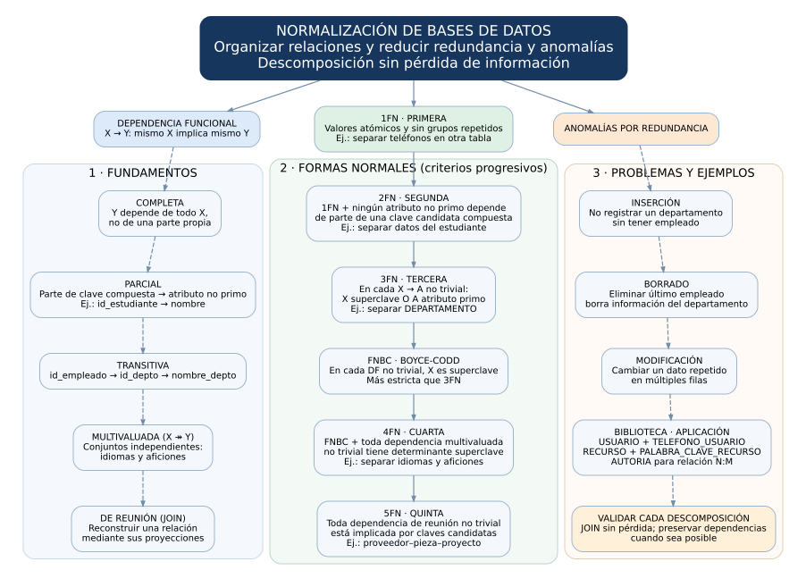

# 📁 Tarea 4.1 — Fundamentos de dependencias y formas normales

**Unidad 4: Normalización de bases de datos**

**Alumno:** Edgar Alejandro Hernández Guajardo  
**Matrícula:** I24050409  
**Docente:** Ing. Ruben Riojas  
**Institución:** Instituto Tecnológico Superior de Monclova

> **Competencia específica:** Aplica el proceso de normalización al diseño de los esquemas de bases de datos para detectar anomalías y garantizar la integridad de la información.

## 📂 Estructura

```text
Tarea 4.1/
├── README.md
├── documentacion/
│   └── Tarea_4.1_Reporte_Tecnico.pdf
└── diagramas/
    ├── mapa_conceptual_normalizacion.mmd
    ├── mapa_conceptual_normalizacion.svg
    ├── mapa_conceptual_normalizacion.pdf
    ├── mapa_conceptual_normalizacion.png
    └── mapa_conceptual_normalizacion.dot
```

## 📑 Entregables

- 📄 [Reporte técnico en PDF](documentacion/Tarea_4.1_Reporte_Tecnico.pdf)
- 🧩 [Mapa conceptual Mermaid (.mmd)](diagramas/mapa_conceptual_normalizacion.mmd)
- 🖼️ [Mapa conceptual vectorial SVG](diagramas/mapa_conceptual_normalizacion.svg)
- 📄 [Mapa conceptual vectorial PDF](diagramas/mapa_conceptual_normalizacion.pdf)
- 🖼️ [Mapa conceptual PNG](diagramas/mapa_conceptual_normalizacion.png)
- ✏️ [Fuente alternativa Graphviz (.dot)](diagramas/mapa_conceptual_normalizacion.dot)

## 🧠 Mapa conceptual



## 📚 Contenido del reporte

Concepto de normalización; dependencias funcionales completas y parciales; dependencias transitivas; anomalías de inserción, borrado y modificación; reglas de 1FN, 2FN, 3FN, FNBC, 4FN y 5FN; ejemplos breves y aplicación al proyecto de biblioteca.

El archivo `.mmd` es editable en Mermaid. El SVG y el PDF son vectoriales y permiten ampliar el mapa sin pérdida de calidad. La composición vectorial se generó con Graphviz a partir de la misma estructura conceptual expresada en Mermaid.


## 🎥 Video explicativo

▶️ Explicación de los temas en YouTube: [VIDEO YOUTUBE](https://youtu.be/RCSFoyRh1VI)

⬅️ [Volver a Unidad 4](../README.md)
