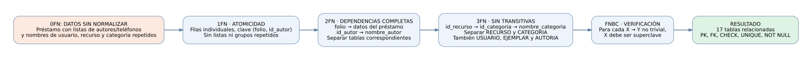

# 📁 Tarea 4.2 — Normalización paso a paso del proyecto de biblioteca

**Unidad 4: Normalización de bases de datos**  
**Alumno:** Edgar Alejandro Hernández Guajardo  
**Matrícula:** I24050409  
**Docente:** Ing. Ruben Riojas  
**Institución:** Instituto Tecnológico Superior de Monclova

> **Competencia específica:** Aplica el proceso de normalización al diseño de los esquemas de bases de datos para detectar anomalías y garantizar la integridad de la información.

## 📑 Entregables

- 📄 [Reporte técnico de normalización (PDF)](documentacion/Tarea_4.2_Reporte_Tecnico.pdf)
- 🗄️ [Script normalizado para SQL Server — normalized_schema.sql](documentacion/normalized_schema.sql)
- 🧪 [Datos ficticios para probar el esquema](documentacion/ejemplos_datos_normalizados.sql)
- 🧩 [Diagrama de transición en Mermaid](diagramas/proceso_normalizacion.mmd)
- 🖼️ [Diagrama vectorial SVG](diagramas/proceso_normalizacion.svg)
- 📄 [Diagrama vectorial PDF](diagramas/proceso_normalizacion.pdf)
- 🖼️ [Diagrama PNG](diagramas/proceso_normalizacion.png)

## 🎯 Objetivo

Analizar una estructura de préstamo bibliotecario con grupos repetidos y dependencias complejas y documentar su transformación a **1FN, 2FN, 3FN** y la verificación de **FNBC** cuando las dependencias declaradas permiten analizarla.

## 🧠 Diagrama del proceso



## 🔍 Resumen de fases

| Etapa | Problema identificado | Corrección |
|---|---|---|
| 0FN | Autores y teléfonos en listas; datos descriptivos repetidos | Identificar grupos repetidos, determinantes y anomalías |
| 1FN | Valores no atómicos | Una fila por elemento; separar teléfonos multivalorados |
| 2FN | Dependencias parciales de (folio, id_autor) | Separar atributos determinados solo por folio o id_autor |
| 3FN | Dependencias transitivas de categoría, recurso y usuario | Crear o conservar tablas CATEGORIA, RECURSO y USUARIO, con FK |
| FNBC | Posibles determinantes que no sean superclaves | Comprobar las dependencias funcionales declaradas |

**Importante:** El punto de partida es una vista *didáctica e hipotética* construida con información del proyecto. La base de datos que se entregó en la Tarea 3.2 ya contiene tablas separadas. No se afirma que el esquema implementado estuviera en 0FN.

## 🗄️ Script SQL

El archivo `normalized_schema.sql` mantiene las **17 tablas** y **16 claves foráneas** del esquema de SQL Server utilizado en las actividades anteriores, además de PK, FK, restricciones `CHECK`, `NOT NULL`, `UNIQUE` e índices auxiliares.

Para ejecutarlo:

1. Crea una base de datos nueva en Microsoft SQL Server.
2. Ábrela desde SQL Server Management Studio.
3. Ejecuta `documentacion/normalized_schema.sql`.
4. Verifica que se hayan creado 17 tablas.
5. Ejecuta por separado `documentacion/ejemplos_datos_normalizados.sql` para cargar datos ficticios.

> El script fue revisado de manera estática y está preparado para SQL Server. No se afirma que se haya ejecutado en una instancia real en esta entrega.

## 📂 Organización

```text
Tarea 4.2/
├── README.md
├── documentacion/
│   ├── Tarea_4.2_Reporte_Tecnico.pdf
│   ├── normalized_schema.sql
│   └── ejemplos_datos_normalizados.sql
└── diagramas/
    ├── proceso_normalizacion.mmd
    ├── proceso_normalizacion.svg
    ├── proceso_normalizacion.pdf
    ├── proceso_normalizacion.png
    └── proceso_normalizacion.dot
```

## ✅ Anomalías corregidas

**Inserción:** permitir registrar usuarios, autores y categorías sin crear un préstamo ficticio.  
**Borrado:** conservar el catálogo de recursos y autores aunque se eliminen préstamos.  
**Modificación:** actualizar nombres de categorías o usuarios en un solo lugar sin repetirlos en filas de préstamos.

## 📚 Referencias

- Elmasri, R. y Navathe, S. B. (2016). *Fundamentals of Database Systems* (7.ª ed.). Pearson.
- Silberschatz, A., Korth, H. F. y Sudarshan, S. (2019). *Database System Concepts* (7.ª ed.). McGraw-Hill.
- [Microsoft Learn — CREATE TABLE (Transact-SQL)](https://learn.microsoft.com/sql/t-sql/statements/create-table-transact-sql)

⬅️ [Volver al README de la Unidad 4](../README.md)
