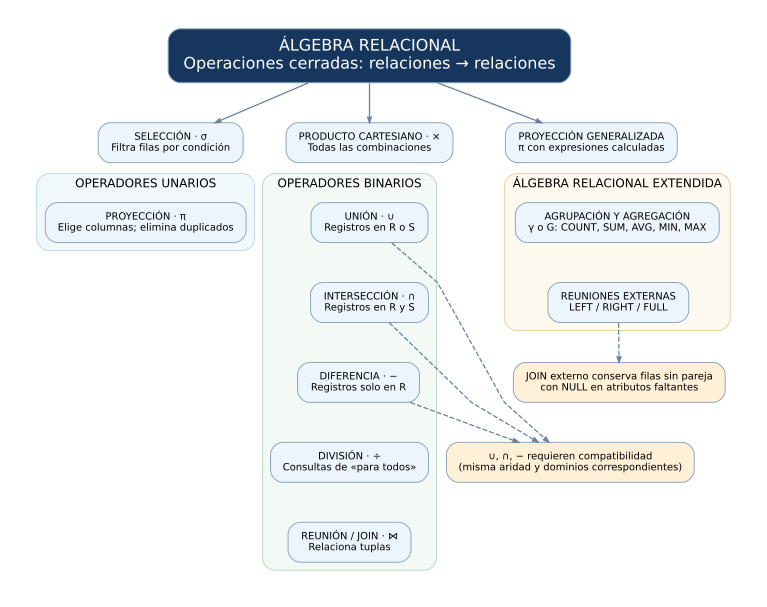

# 📁 Tarea 5.1 — Operadores fundamentales y extendidos del álgebra relacional

**Unidad 5 · Fundamentos de Bases de Datos**

- **Alumno:** Edgar Alejandro Hernández Guajardo
- **Matrícula:** I24050409
- **Docente:** Ing. Ruben Riojas
- **Institución:** Instituto Tecnológico Superior de Monclova

## 🎯 Objetivo

Investigar la notación formal, el significado y ejemplos de los operadores del álgebra relacional clásica y extendida, aplicándolos al proyecto de biblioteca académica.

## 📑 Entregables

- 📄 [Reporte técnico PDF](documentacion/Tarea_5.1_Reporte_Tecnico.pdf)
- 📝 [Archivo fuente del informe técnico — Markdown](documentacion/Tarea_5.1_Informe_Tecnico.md)
- 🧩 [Mapa conceptual Mermaid editable](diagramas/mapa_conceptual_algebra_relacional.mmd)
- 🖼️ [Mapa conceptual SVG vectorial](diagramas/mapa_conceptual_algebra_relacional.svg)
- 📄 [Mapa conceptual PDF vectorial](diagramas/mapa_conceptual_algebra_relacional.pdf)
- 🖼️ [Mapa conceptual PNG](diagramas/mapa_conceptual_algebra_relacional.png)
- ✏️ [Fuente alternativa Graphviz DOT](diagramas/mapa_conceptual_algebra_relacional.dot)

## 🧠 Mapa conceptual



## 📚 Operadores estudiados

| Tipo | Operador | Notación | Función |
|---|---|---|---|
| Unario | Selección | σ | Filtrar filas por condición |
| Unario | Proyección | π | Elegir atributos y eliminar duplicados |
| Binario | Producto cartesiano | × | Obtener todas las combinaciones de tuplas |
| Binario | Unión | ∪ | Filas presentes en cualquiera de dos relaciones |
| Binario | Intersección | ∩ | Filas comunes |
| Binario | Diferencia | − | Filas presentes solo en la primera relación |
| Binario | División | ÷ | Expresar condiciones de tipo «para todos» |
| Binario | Reunión / join | ⋈ | Combinar filas relacionadas |
| Extendido | Proyección generalizada | π con expresiones | Calcular atributos derivados de una consulta |
| Extendido | Agrupación y agregación | γ o G | COUNT, SUM, AVG, MIN y MAX |
| Extendido | Left / right / full outer join | ⟕ / ⟖ / ⟗ | Conservar filas sin pareja, utilizando NULL |

**Consideraciones:** unión, intersección y diferencia requieren relaciones compatibles para unión. La semántica clásica de proyección elimina duplicados; SQL puede conservarlos. El mapa se incluye dentro del PDF en una página A3 horizontal con gráficos vectoriales.

## 🗂️ Estructura de archivos

```text
Tarea 5.1/
├── README.md
├── documentacion/
│   ├── Tarea_5.1_Reporte_Tecnico.pdf
│   └── Tarea_5.1_Informe_Tecnico.md
└── diagramas/
    ├── mapa_conceptual_algebra_relacional.mmd
    ├── mapa_conceptual_algebra_relacional.svg
    ├── mapa_conceptual_algebra_relacional.pdf
    ├── mapa_conceptual_algebra_relacional.png
    └── mapa_conceptual_algebra_relacional.dot
```

## 🔗 Referencias

- [Brown University — Relational Algebra](https://cs.brown.edu/courses/cs127/website_2020/static/files/slides2020/RelationalAlgebra.pdf)
- [UNSW — Relational Algebra](https://cgi.cse.unsw.edu.au/~cs3311/23T3/notes/C/notes.html)
- [RPI — Relational Model and Relational Algebra](https://cs.rpi.edu/~sibel/csci4380/fall2025/course_notes/relational_algebra.html)
- [OpenStax — Relational Database Management Systems](https://openstax.org/books/introduction-computer-science/pages/8-3-relational-database-management-systems)

⬅️ [Volver a Unidad 5](../README.md)
