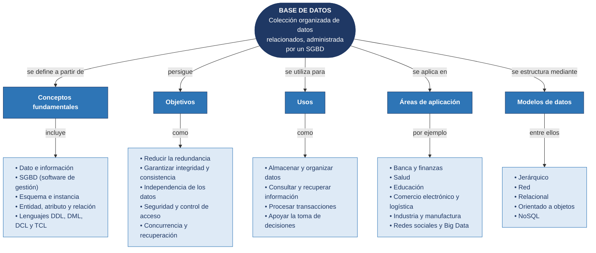

# Tarea 1.1: Fundamentos, objetivos y modelos de bases de datos

## Datos del alumno

| | |
|---|---|
| **Alumno** | Edgar Alejandro Hernandez Guajardo |
| **Matrícula** | I24050409 |
| **Docente** | Ing. Ruben Riojas |
| **Institución** | Instituto Tecnológico Superior de Monclova |
| **Unidad** | Unidad 1 |
| **Actividad** | Tarea 1.1 |

## Descripción de la tarea

En esta tarea se investigan los conceptos fundamentales, los objetivos, los usos y las áreas de aplicación de las bases de datos, y se sintetizan en un mapa conceptual. Además, se estudian los principales modelos de bases de datos (jerárquico, red, relacional, orientado a objetos, objeto-relacional y NoSQL) y se comparan en una tabla que detalla su definición y su forma de representar los datos.

## 📄 Documentación

👉 [**Ver documento PDF de la Tarea 1.1**](documentacion/Tarea_1.1_Bases_de_Datos.pdf)

## Estructura de la carpeta

```
Unidad1/
└── Tarea 1.1/
    ├── Readme.md
    ├── documentacion/
    │   └── Tarea_1.1_Bases_de_Datos.pdf
    └── diagramas/
        └── 01_mapa_conceptual_bases_de_datos.(mmd|svg|png)
```

El archivo `.mmd` es la **fuente vectorial editable** (Mermaid); el `.svg` y el `.png` son sus renders.

## 1. Mapa conceptual



## 2. Tabla comparativa de modelos de bases de datos

| Modelo | Definición | Forma de representación de los datos |
|---|---|---|
| **Jerárquico** | Organiza los datos en una estructura de árbol en la que cada registro hijo depende de un único padre. | Segmentos enlazados con relaciones padre–hijo 1:N; el acceso se hace recorriendo el árbol desde la raíz. |
| **Red** | Extiende el jerárquico permitiendo que un registro tenga varios padres (CODASYL). | Grafo de registros conectados mediante *sets*; las relaciones N:M se resuelven con registros de enlace. |
| **Relacional** | Representa los datos como relaciones matemáticas basadas en teoría de conjuntos (Codd, 1970). | Tablas con filas (tuplas) y columnas (atributos), relacionadas por claves primarias y foráneas; se consulta con SQL. |
| **Orientado a objetos** | Almacena la información como objetos con atributos y métodos, como en la programación orientada a objetos. | Objetos con identidad propia agrupados en clases, con herencia, encapsulamiento y polimorfismo. |
| **Objeto-relacional** | Híbrido que amplía el modelo relacional con características de objetos. | Tablas con tipos definidos por el usuario, tablas anidadas y herencia; SQL extendido. |
| **NoSQL** | Familia de modelos no relacionales para gran volumen y variedad de datos, con esquema flexible. | Documentos (JSON/BSON), clave–valor, familias de columnas o grafos. |

> La tabla completa (con ventajas, limitaciones y ejemplos) está en el [documento PDF](documentacion/Tarea_1.1_Bases_de_Datos.pdf).

## Cómo regenerar el diagrama

```bash
npm install -g @mermaid-js/mermaid-cli
mmdc -i diagramas/01_mapa_conceptual_bases_de_datos.mmd -o diagramas/01_mapa_conceptual_bases_de_datos.svg
```

## Referencias (APA 7)

- Bachman, C. W. (1973). The programmer as navigator. *Communications of the ACM, 16*(11), 653–658. https://doi.org/10.1145/355611.362534
- Codd, E. F. (1970). A relational model of data for large shared data banks. *Communications of the ACM, 13*(6), 377–387. https://doi.org/10.1145/362384.362685
- Connolly, T., & Begg, C. (2015). *Database systems: A practical approach to design, implementation, and management* (6.ª ed.). Pearson.
- Coronel, C., & Morris, S. (2019). *Database systems: Design, implementation, & management* (13.ª ed.). Cengage Learning.
- Date, C. J. (2004). *An introduction to database systems* (8.ª ed.). Addison-Wesley.
- Elmasri, R., & Navathe, S. B. (2016). *Fundamentals of database systems* (7.ª ed.). Pearson.
- Sadalage, P. J., & Fowler, M. (2012). *NoSQL distilled: A brief guide to the emerging world of polyglot persistence*. Addison-Wesley.
- Silberschatz, A., Korth, H. F., & Sudarshan, S. (2019). *Database system concepts* (7.ª ed.). McGraw-Hill Education.

## 🎥 Video explicativo

▶️ Explicación de los temas en YouTube: [VIDEO YOUTUBE](https://youtu.be/jaNzTkPIRsw)
