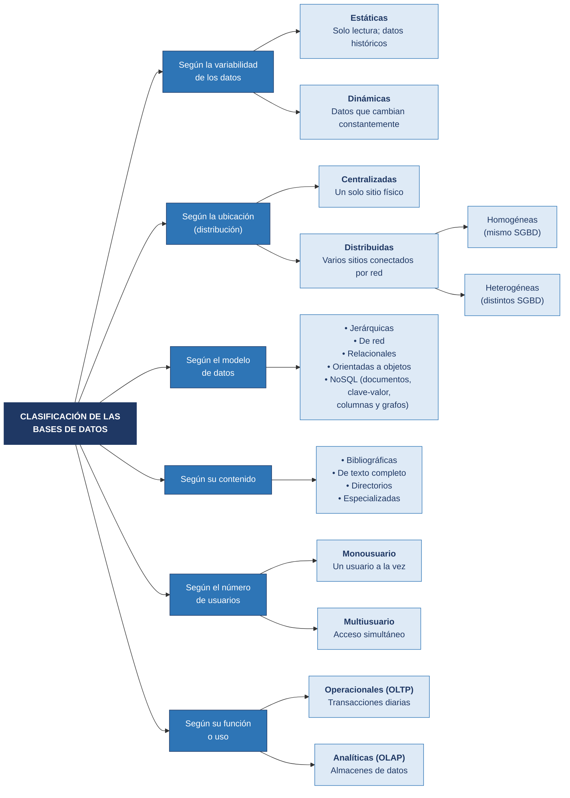
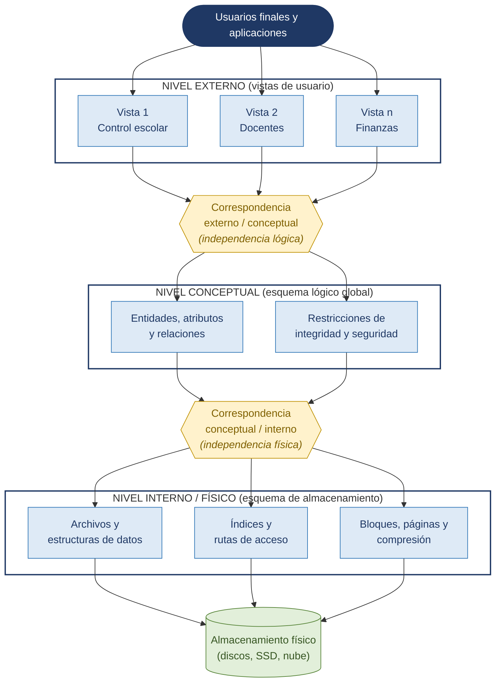
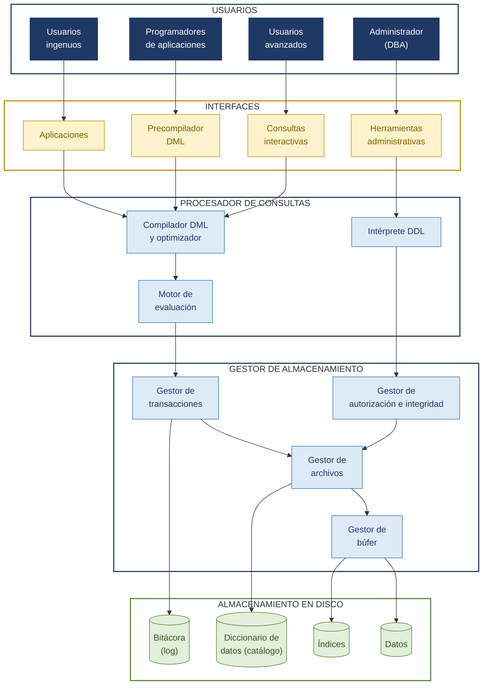

# Tarea 1.2: Clasificación y arquitecturas (ANSI/SPARC y SGBD)

## Datos del alumno

| | |
|---|---|
| **Alumno** | Edgar Alejandro Hernandez Guajardo |
| **Matrícula** | I24050409 |
| **Docente** | Ing. Ruben Riojas |
| **Institución** | Instituto Tecnológico Superior de Monclova |
| **Unidad** | Unidad 1 |
| **Actividad** | Tarea 1.2 |

## Descripción de la tarea

En esta tarea se investiga la clasificación de las bases de datos según distintos criterios (ubicación, variabilidad de los datos, modelo, contenido, número de usuarios y función) y se resume en un cuadro sinóptico. Además, se describe y esquematiza la arquitectura de tres niveles de una base de datos (externo, conceptual e interno) propuesta por ANSI/SPARC, así como la arquitectura funcional interna de un Sistema Gestor de Bases de Datos (SGBD).

## 📄 Documentación

👉 [**Ver documento PDF de la Tarea 1.2**](documentacion/Tarea_1.2_Clasificacion_y_Arquitecturas.pdf)

## Estructura de la carpeta

```
Unidad1/
└── Tarea 1.2/
    ├── Readme.md
    ├── documentacion/
    │   ├── Tarea_1.2_Clasificacion_y_Arquitecturas.docx
    │   └── Tarea_1.2_Clasificacion_y_Arquitecturas.pdf
    └── diagramas/
        ├── 01_cuadro_sinoptico_clasificacion.(mmd|svg|png)
        ├── 02_arquitectura_tres_niveles_ansi_sparc.(mmd|svg|png)
        └── 03_arquitectura_funcional_sgbd.(mmd|svg|png)
```

Los archivos `.mmd` son las **fuentes vectoriales editables** (Mermaid); los `.svg` y `.png` son sus renders.

## 1. Cuadro sinóptico: clasificación de las bases de datos



## 2. Arquitectura de tres niveles (ANSI/SPARC)

| Nivel | Descripción |
|---|---|
| **Externo** | Vistas de usuario: muestran a cada grupo solo la parte de la base de datos que le interesa. |
| **Conceptual** | Esquema lógico global: entidades, atributos, relaciones y restricciones de integridad. |
| **Interno (físico)** | Esquema de almacenamiento: archivos, índices, rutas de acceso y estructuras físicas. |

Las correspondencias entre niveles proporcionan la **independencia lógica** (externo/conceptual) y la **independencia física** (conceptual/interno).



## 3. Arquitectura funcional interna del SGBD



> La explicación detallada de cada componente está en el [documento PDF](documentacion/Tarea_1.2_Clasificacion_y_Arquitecturas.pdf).

## Cómo regenerar los diagramas

```bash
npm install -g @mermaid-js/mermaid-cli
mmdc -i diagramas/01_cuadro_sinoptico_clasificacion.mmd -o diagramas/01_cuadro_sinoptico_clasificacion.svg
```

## Referencias (APA 7)

- Connolly, T., & Begg, C. (2015). *Database systems: A practical approach to design, implementation, and management* (6.ª ed.). Pearson.
- Coronel, C., & Morris, S. (2019). *Database systems: Design, implementation, & management* (13.ª ed.). Cengage Learning.
- Date, C. J. (2004). *An introduction to database systems* (8.ª ed.). Addison-Wesley.
- Elmasri, R., & Navathe, S. B. (2016). *Fundamentals of database systems* (7.ª ed.). Pearson.
- Özsu, M. T., & Valduriez, P. (2020). *Principles of distributed database systems* (4.ª ed.). Springer. https://doi.org/10.1007/978-3-030-26253-2
- Silberschatz, A., Korth, H. F., & Sudarshan, S. (2019). *Database system concepts* (7.ª ed.). McGraw-Hill Education.
- Tsichritzis, D., & Klug, A. (Eds.). (1978). The ANSI/X3/SPARC DBMS framework: Report of the Study Group on Database Management Systems. *Information Systems, 3*(3), 173–191. https://doi.org/10.1016/0306-4379(78)90001-7

## 🎥 Video explicativo

▶️ Explicación de los temas en YouTube: [VIDEO YOUTUBE](https://youtu.be/Ea9HYa_0brs)
